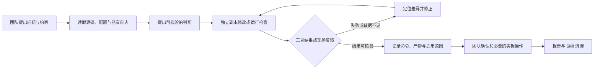

# EagleEye 大模型协作与工程实践

## 一、协作总体方案

EagleEye 在 XC7Z035 上结合视频处理、FPGA 预处理、ARM 端 PicoDet、注意力选择和局部观察。开发中，团队负责确定场景、提出约束、选择方案及操作开发板；Codex 读取工程与工具输出，辅助分析接口、修改独立候选、组织验证和整理可复现材料。方案是否有效，最终以源码、实际工具结果和现场记录为依据。

本报告围绕真实工程案例呈现**提示词、模型回答、纠错轨迹和协作工作流**。聊天摘录保留原文；历史工程复盘中的模型处理明确标为摘要。[会话证据索引](ai_collaboration_evidence_20261030.md)和[补充来源摘录](ai_collaboration_excerpts_20261031.md)记录来源。

| 证据类别 | 报告中的含义 |
|---|---|
| 用户或现场反馈 | 团队提出的任务、观察到的现象和现场确认 |
| 工具或文件记录 | 实际构建日志、测试输出、源码或数据文件 |
| 模型判断 | Codex 在当时给出的分析、处理方案及结果说明，仍需结合证据核对 |

当前视频系统的模型推理在 ARM 端执行，FPGA 用于视频及图像预处理。V2 卷积卸载按**历史独立实验**记录，当前 Eyes 的功能与性能采用视频系统自身的测试资料。

## 二、典型协作案例

### 案例 1：Vivado 无法启动，逐步恢复工程构建

**背景与指令。** 团队希望判断仓库能否从源码复现。用户首先提出：“请你尝试一下GitHub上面的内容是否能够复现”。首次独立尝试中，Codex 报告 Vivado 2022.2 启动即退出 `0xC0000135`，未进入 Tcl；随后用户要求继续排查，并验证 BD、综合、实现和 BIT 生成。

**模型回答与迭代。** Codex 记录：“通过 WSL 启动独立的 Windows 命令进程，Vivado 2022.2 已正常启动”。它没有把进程启动失败直接归因于工程源码：先核查工具启动环境，再尝试通过 WSL 启动独立 Windows 进程。Vivado 能启动后，问题转移到工程本身：重建脚本遗漏 BD 配套 IP 配置，之后又遇到模块更新及旧生成路径问题。补齐配置并修正独立副本中的路径后，BD 校验与目标生成才完成。

这次排查也暴露了操作边界：旧路径处理期间，Vivado 曾在安装目录自动生成临时文件；会话保留了临时文件的生成位置，便于后续排查和恢复环境。首次复现中的源码补充和路径处理与后续仓库构建脚本更新是不同步骤。

**验证与后续纠错。** 之后团队再次要求从 GitHub 干净复现。那次布线开始后中断，Codex 先确认综合和布局检查点，再从布线阶段续跑，而非将中间状态当成完成。最终生成 BIT/XSA，已约束路径 WNS **+0.608 ns**、WHS **+0.007 ns**；该 STA 结果覆盖已约束路径；I/O 与 CDC 的专项状态见告警说明，该次新文件独立板测为后续验证项。

**可核查材料：**[原始会话摘录](ai_collaboration_evidence_20261030.md)、[干净复现记录及日志](clean_reproduction_20261028_zh.md)、[构建入口](../build/build_full_vivado.tcl)、[告警说明](warning_review_zh.md)。

**协作价值。** 模型将启动环境、BD/IP 依赖和实现状态分阶段检查，并根据失败结果改变下一步；团队提出“不修改稳定工程”的约束，工具报告则决定哪些结论可以成立。

### 案例 2：从仿真通过到板端固定输入 Golden

**提示词与模型回答。** 预处理 IP 的需求明确输入“640×360 RGB888”和输出“1×3×320×320、FP32、NCHW”。模型回答：“核心 RTL 和控制接口已经落地。插值权重可精确表示为整数分数，归一化则由随源码交付的 FP32 查找表完成”。[原始摘录](ai_collaboration_excerpts_20261031.md)记录了提示词与回答。

**实现与工具反馈。** 历史工作为 32 位 DMA 字节流补充输入适配器，联合检查张量顺序及背压。模型记录：“从干净压缩包解压后，Vivado 2024.2 已成功重新打包”；Icarus 12 开发版重复编译出现间歇性进程崩溃后，又准备 Vivado 仿真路径。独立 IP 的历史结果与当前完整工程的 Vivado 2022.2 构建分别记录，见[来源摘录](ai_collaboration_excerpts_20261031.md)和[仿真说明](../sim/verification_zh.md)。

**背景与指令。** 已有预处理 RTL 仿真结果，但当时没有同一固定输入下的板端输出对照。Codex 在核查比赛材料时明确指出：“板端同输入预处理输出与 Golden 的逐值对比未测试”。用户随后要求整理可执行的板端对比方法。

**方案与反馈。** 流程要求固定输入图像，保存 FPGA 预处理的完整 FP32 张量，以相同算法的参考张量逐值比较，并记录版本和运行日志。现场返回数据后，Codex 核验归档及内部文件哈希，再用仓库工具复核张量，并将主机复核、RTL 与真实板端结果分别记录：

```sh
python -B skill/preproc-fp32-golden/tools/verify_tensor.py --actual board/measurements/preproc_golden_20261029/board_tensor.f32 --golden data/captured.golden.f32 --shape 1x3x320x320 --atol 1e-6 --rtol 0 --require-exact
```

**结果。** 在记录的这一张固定输入上，**307,200/307,200 个 FP32 值逐位一致**，最大和平均绝对误差均为 0。该结果覆盖此固定输入的预处理张量；独立 BIT 关联仍待核对，整网精度和实时视频帧新鲜度由各自专项验证。

这一案例展示了从 RTL 到**新增实板证据后更新结论**的验证递进。

**可核查材料：**[用户请求和模型结论摘录](ai_collaboration_evidence_20261030.md)、[板端 Golden 结果及原始文件](preproc_board_golden_20261029_zh.md)、[RTL 验证说明](../sim/verification_zh.md)。

**协作价值。** 模型把“画面能运行”和“张量计算正确”拆成可分别检查的问题；固定输入的真实执行和数据回收由现场人员完成。

### 案例 3：人体框接入注意力模块时发现 Python 兼容错误

**提示词与回答。** 用户提出“在独立副本中完成接口适配、无目标处理和离线联调验证”。遇到写入错误后，Codex 回答：“此前发现并修复了 WSL 自带 Python 对文件写入参数的不兼容。”目标 ID 和板端效果当时继续等待确认；[原始摘录](ai_collaboration_evidence_20261030.md)记录了指令、错误与回答。

**首次方案。** Codex 将保存的检测结果转换为下游可读取的数据流，检查坐标、置信度和人数边界；对无有效目标的情况停止生成旧目标请求，同时清理调度及平滑状态。目标编号采用本地临时关联，PicoDet 输出与关联 ID 分别定义。

**发现问题与修正。** 离线入口首次在 WSL 环境执行时，工具返回：

```text
REJECTED: write_text() got an unexpected keyword argument 'newline'
```

Codex 随后将写入方式改为通过文件对象 `open(..., newline='\n')` 输出，并增加命令行生成与防覆盖检查。定向测试记录为 **5 项通过**；该项完成离线适配器验证，实时硬件接入按后续阶段测试。

**进一步接线与验证。** 在用户要求继续接入板端程序独立副本后，团队确认当前检测 JSON 没有对外稳定 `target_id`。候选因此保留临时 ID 和无目标处理；ARM 交叉编译后，QEMU 纯 CPU、离线输入测试中，7 个人体结果与原程序一致，并生成注意力 ROI 请求。记录中的 `hardware_commit=not_attempted` 明确表示该 QEMU 测试没有操作 Fovea 硬件。

现场后来确认使用新候选程序上板功能正常；仓库中另有 AttentionPolicy 的应用日志，两者对应不同 ELF，现场反馈与应用日志分别归档。

**可核查材料：**[原始会话与工具错误摘录](ai_collaboration_evidence_20261030.md)、[独立候选源码与说明](../src/picodet_c_candidate/readme.md)、[QEMU 人体框和请求](../sim/picodet_c_candidate/qemu_predictor.txt)、[主机测试摘要](../sim/picodet_c_candidate/host_results.txt)、[现场功能与应用日志范围](board_app_evidence_20261028_zh.md)。

**协作价值。** AI 的具体作用是把检测输出转成可检查的接口契约，并根据真实运行错误修正文件写入方式；团队提供的 ID 信息和现场反馈决定了跟踪结论的边界。

### 案例 4：视频模式、鼠标与 ROI 联调

**提示词与反馈。** 现场反馈“这次按了key0就黑屏”，并提出“好像鼠标没反应”。这些语句来自既有工程复盘的转录。

**模型处理与纠错。** 针对暂停后切换模式，复盘记录了从推理进程转向显示状态、帧边界和模式状态机的排查；针对鼠标问题，处理顺序从应用事件延伸到 Linux input、USB 驱动绑定和设备树。现场反馈帮助区分了推理进程与显示链路，并将鼠标排查从应用坐标推进到设备枚举。

**画面反馈。** 工程复盘还转录了对 ROI 红色细框和标题拼写的具体反馈；模型按这些要求修正框线、标题和显示文案。该过程按复盘摘要呈现，原始连续画面未随材料归档。

**验证范围。** 工程复盘记载调整后模式状态文字可用、鼠标可改变 ROI；现场已确认鼠标 ROI、按键和 HDMI 功能正常。逐步处理为复盘摘要，原始完整回合和连续演示录像未随材料提供。源码与证据见 [视频模式](../src/vivado/eagleeye_7035_eyes.srcs/sources_1/imports/rtl/video_mode_switch_top.v)、[鼠标控制](../src/ps/src/mouse_roi_controller.cpp)、[功能记录](board_app_evidence_20261028_zh.md)及[复盘摘录](ai_collaboration_excerpts_20261031.md)。

### 案例 5：双轴机械眼的 PWM 与舵机型号

**提示词与反馈。** 既有工程复盘转录了“我现在打算用板子控制两个舵机，做一个两自由度的仿生机械眼”，以及上板后对 360 度 SG90 持续转动的反馈。

**模型处理与纠错。** 模型协助将 ROI 坐标映射为双路受限 PWM，并检查引脚、电压与供电。持续转动的反馈促使团队区分位置舵机与连续旋转舵机；前者的脉宽到角度映射不能直接用于后者。此处为工程复盘摘要。

**验证范围。** [PWM RTL 仿真](../sim/servo_iverilog_20261027.log)覆盖中心、周期和渐变，现场确认舵机功能正常；实物型号、机械误差及响应延迟以实测记录为准。对应 [舵机 RTL](../src/servo/roi_servo_pwm.v) 和[来源摘录](ai_collaboration_excerpts_20261031.md)。

其他模型来源和演示版本的历史核对见 [补充案例](ai_collaboration_supplement_20261031.md)。

### 案例 6：性能统计中区分配置收益与同算法加速比

**背景。** 为评估预处理优化，团队提供两组板端日志。每组记录 35 帧，丢弃前 5 帧后统计 30 帧。

**模型判断。** Codex 阅读实际配置后指出：“CPU 使用双三次缩放、FPGA 使用双线性缩放”，且两组是先后采集的实时画面，因此不能作为同算法、同一图像的精度对照。

**实际重算。** 运行 `python -B tools/summarize_preproc_ab.py board/measurements/preproc_ab_20261028`，可得到两种配置的平均值：

| 计时项 | CPU 双三次 | FPGA 双线性 |
|---|---:|---:|
| 预处理 | 416.960 ms | 17.537 ms |
| ARM Predictor | 468.659 ms | 468.204 ms |
| 采集至检测解析结束 | 903.150 ms | 502.665 ms |

这些结果反映两种实际配置的计时收益；同算法性能及 HDMI 刷新、检测更新分别使用对应测量口径。日志中的 VDMA 错误位提示和 `freshness=unverified` 同时保留。

该案例体现 AI 对配置、计时区间与统计口径的联合核对，帮助团队形成可复算的性能分析。

**可核查材料：**[会话摘录](ai_collaboration_evidence_20261030.md)、[测试条件、原始日志与重算方法](preproc_ab_20261028_zh.md)、[统计脚本](../tools/summarize_preproc_ab.py)。

### 案例 7：BusyBox 功能差异暴露现场采集脚本问题

**问题与纠错。** 历史 V2 的只读采集需要兼容缺少 `timeout` 的 BusyBox，同时保留时间和读取量上限。Codex 基于进程组的首版限时方案完成语法及 **21 项 PC/WSL 夹具检查**，当时尚未板端验证；现场随后报告 `head: invalid option -- 'c'`，脚本在创建输出目录前退出。根据反馈，限字节读取改为 `dd bs=1 count=N`，`head` 只用于限行，并加入拒绝 `head -c` 的夹具；修订记录报告 **25 项定向检查通过**。

**范围与来源。** 该采集脚本属于历史 V2 实验，采集结果与现场启动准入分别判断。[原始指令、现场错误和修订结论](ai_collaboration_evidence_20261030.md)可供追溯；完整脚本和测试文件保存在本地历史实验中。

### 案例 8：独立卷积实验的性能反馈

历史 V2 独立实验中，驱动返回 `-22`，Codex 为时钟及其他拒绝分支增加诊断；当时日志不足以确定唯一原因。后续板端 Golden **21/21 零差异**，但完整 Predictor 从 ARM **815.568 ms** 增至 V2 **861.566 ms**，说明数值正确和整网净收益需要分别评价。该实验独立于当前 Eyes 视频工程；[补充报告](ai_collaboration_supplement_20261031.md)和[原始反馈](ai_collaboration_evidence_20261030.md)记录纠错及证据。

## 三、Codex 智能体工作流

下面的流程概括上述案例中实际执行过的步骤。它描述团队与 Codex 的协作，现有记录没有固定多智能体编排的证据。不是每个任务都涉及源码修改或实板测试；例如 Golden 的现场执行由团队完成，Codex 负责整理方法和复核回传数据。



| 阶段 | 实际使用的工具或产物 | 人工职责 |
|---|---|---|
| 定位与构建 | Git、Python、WSL、Vivado Tcl 与日志；独立目录生成 BIT/XSA | 确认目标版本、工程约束与操作边界 |
| 数值与接口检查 | 主机测试、RTL 仿真、QEMU、张量比较和日志重算脚本 | 提供现场问题、固定输入和测试条件 |
| 板端反馈 | 回传串口、结果文件、哈希及功能反馈 | 执行授权操作、恢复稳定系统并确认实际现象 |
| 归档与复现 | Git 提交、文件清单、测试记录和技能示例 | 核对成果归属、来源与比赛提交范围 |

## 四、Skill 与工程经验复用

项目把验证中反复出现的问题整理进统一的 [Skill 目录](../skill/index.md)。例如，[预处理 Golden](../skill/preproc-fp32-golden/readme.md)明确张量输入、形状和逐值比较方法；[ROI 复判控制](../skill/roi-review-control/readme.md)提供接口合同检查；[AXI 视频流回归](../skill/01-axi-video-regression/skill.md)关注握手、反压和帧边界；[PYNQ Overlay 与 DMA](../skill/pynq-overlay-dma/readme.md)提供寄存器、DMA 和缓存处理示例。

**提示词与模型回答。** 团队提出“我们比赛需要整理skills”，模型回答：“每项都有**适用范围、操作步骤、提示词、失效条件、验证结果和踩坑来源**”。[来源摘录](ai_collaboration_excerpts_20261031.md)保存了相关对话；验证范围以各项记录为准。

这些技能包含适用范围、使用方法、示例或测试与失败条件。主机夹具用于验证工具行为，目标硬件按板端流程验收；PYNQ 示例已完成离线模拟，实板及真实跨项目复用留待后续迁移验证。各项结果见 [Skill 验证说明](../skill/validation.md)。

## 五、协作成果与反思

本项目中，AI 将复杂工程问题转化为可执行的接口检查、构建命令和验证脚本，帮助团队快速定位依赖、复核数据并组织可复现材料。现场反馈推动工具迭代：BusyBox 的真实选项差异进入回归，局部数值结果与整网性能分开评估，BIT 构建与外设时序及板端功能分别验收。

团队负责目标取舍、现场操作和成果确认，AI 通过可追溯的分析与自动化工具辅助执行。协作价值由上述工程案例及验证结果体现，工时节省暂无量化统计。仓库保留相关会话节选与测试依据，完整会话及部分历史构建、串口仍存于本地来源资料。

当前报告修改前版本可从 Git 历史提交 `85497c1` 中恢复：

```sh
git show 85497c1:report/ai_collaboration_record.md
```
