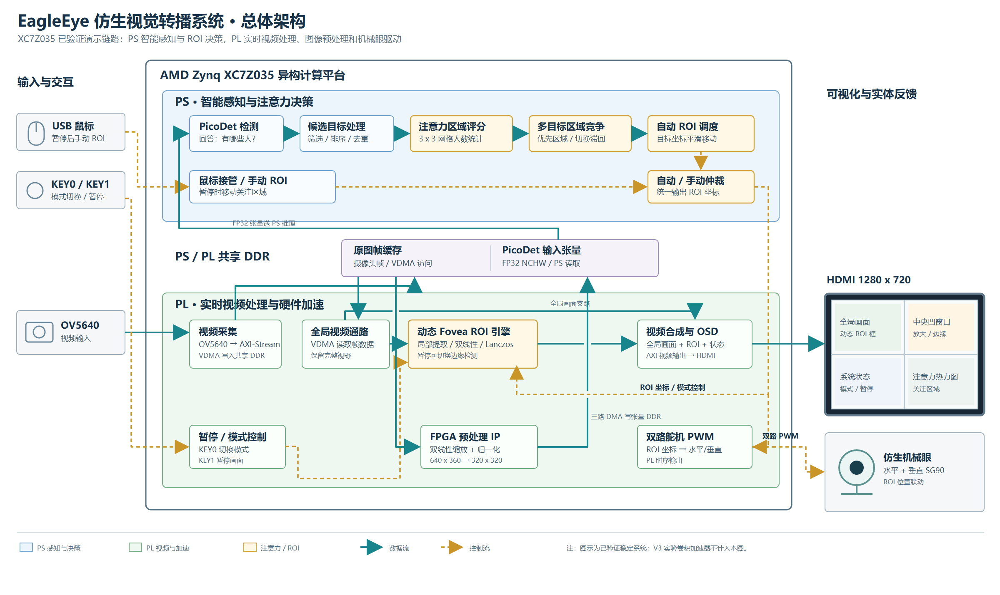
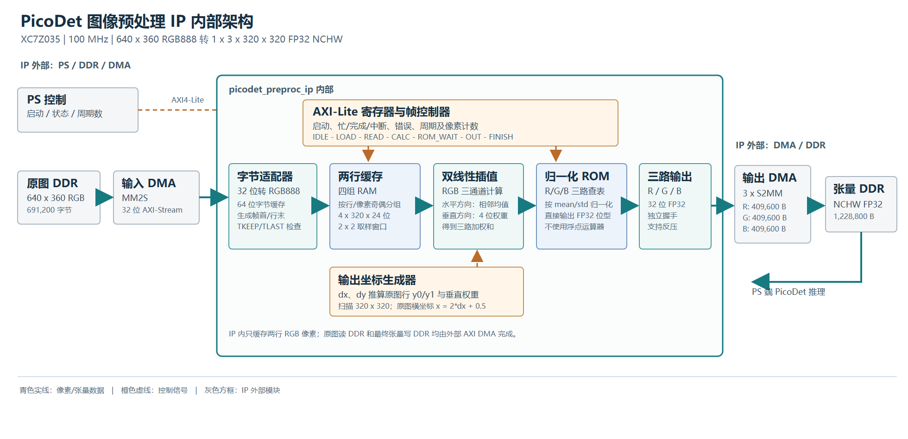

# EagleEye Z035 摄像头辅助观察系统——设计报告

**状态：提交整理稿。**已有内容依据仓库源码、工具报告、实板日志及 A 的现场确认编写；已有 CPU/FPGA 预处理 A/B 耗时记录，以及一次[独立板端固定输入 Golden 对比](preproc_board_golden_20261029_zh.md)；两次测试的 BIT 身份关系和最终发布版本仍待确认。A、B、C 的主要职责按团队确认记录。 本报告对应 Z035 Eyes 基线与 A 的后续上板交接；具体 BIT、应用和模型身份见 [版本说明](release_identity_zh.md)。不把独立 V2/V3 卷积实验当作该系统已经集成的功能。

评审可从 [比赛材料与证据索引](contest_evidence_index_zh.md)查看每项要求对应的源码、报告、原始日志和验证边界。

## 1. 背景、目标和范围

系统面向快速运动场景的辅助观察：保留摄像头全景显示，使用人体检测产生关注区域，提供局部放大、暂停和鼠标复判，并由双路舵机跟随。它是观察辅助系统，现有证据不能支持自动裁判结论或完整检测准确率数值。

实现使用 XC7Z035、OV5640、HDMI 和 ARM/Paddle-Lite。视频局部放大、预处理和检测是不同功能；ROI 放大并不代表新增真实图像细节。下列内容是本项目可核查的设计特点与拟申报方向；本节已补充相关公开工作的定性对照；同算法、同一固定输入的性能及精度对比尚未完成，不能据此宣称首次提出或业界领先。

### 1.1 选题动机与实际需求

在足球等快速运动的画面中，观察者既要理解运动员在场地中的相对位置，也可能需要看清人物附近的局部细节。目标运动、遮挡、距离和屏幕显示尺寸都会增加观察难度：只看全景时局部目标较小；只盯住局部又容易失去场景上下文。人工在暂停画面中寻找和调整关注区域，也需要反复操作。

团队因此选择“全景观察与局部复判相结合”作为本项目的切入点：在一套嵌入式设备上保留全景画面，尝试根据人体检测结果提出关注区域，并提供暂停后由鼠标调整 ROI 的方式，供使用者观察细节；双路舵机用于演示随 ROI 变化的机械控制。这里的“复判”指对**当前暂停画面**的人工观察；现有材料不证明具备多机位、历史片段回放、慢动作或轨迹回放功能。

这一方案希望减少使用者在全景和局部之间寻找目标、调整观察区域的操作负担。但目前没有针对观察效率、使用体验或判断准确率的对照实验，不能宣称已经量化证明效果；当前模型输出的是人体框，不包含已验证的足球检测或球员身份识别。单摄像头视角、画面遮挡、低分辨率、检测误差和放大不产生原始画面中不存在的细节，均限制观察结果。

本项目定位为教学与研究性质的画面观察辅助原型，**不是正式 VAR 系统，也不能自动作出比赛裁判结论**。其设计目标和已有功能应与实际采集、原始测试记录和最终演示版本一起理解，不能把目标直接写成实测效果。

### 1.2 相关工作及本项目的区别

| 方向及代表性已有工作 | 已有方案解决什么 | 本项目采用或借鉴的部分、主要区别 |
|---|---|---|
| 专业视频回看与 VAR | FIFA 的场馆技术说明介绍了使用比赛转播画面进行视频复核，以及可用于分析的光学跟踪系统 [1]；IFAB 的 VAR 协议规定了受限的复核情形、程序和裁判最终决定权 [2]。 | EagleEye 结合单摄像头全景、暂停画面局部观察与人工 ROI 控制，旨在做观察辅助。现有工程没有证明实现专业 VAR 的多机位回放、赛事流程、认证或裁判系统能力，因此不能称其为 VAR 替代品。 |
| 轻量目标检测 | Yu 等提出 PP-PicoDet，研究轻量骨干、检测结构及移动端精度与效率的权衡 [3]；PaddleDetection 提供 PicoDet 的模型配置和部署说明 [4]。 | 本项目使用已有 PicoDet/Paddle-Lite 方案在 PS 侧产生人体框，并将其接入注意力和 ROI 控制。PicoDet 不是团队原创；论文中的移动设备性能也不是 XC7Z035 的实测性能。已有临时 ID 不等于跨遮挡稳定跟踪。 |
| FPGA 图像处理与预处理 | AMD 的 Vitis Vision 库提供颜色转换、分辨率变换等硬件图像处理功能 [5]，说明这类运算已有成熟的可编程逻辑实现思路。 | 本项目将已有工程中的 PL 预处理接入摄像头、PicoDet 与视频观察链路，并以张量 Golden 校验指定仿真输入。不能把缩放或 FPGA 预处理本身表述成首次提出；当前已有不同预处理算法的板端 A/B 计时；同算法及固定输入对照仍待测试。 |

**本项目拟体现的贡献**是上述功能面向同一观察场景的软硬件组合：将视频显示和预处理、PS 人体检测、ROI 人工接管及舵机控制组织成一套 XC7Z035 原型，并保留对应源码与复现材料。已有工作分别覆盖视频复核、检测和硬件图像处理；本报告没有与其他完整系统开展同条件实验，因此不声称本原型在成本、精度、速度或适用性上优于它们。具体实现与验证边界见下表及第 3、4 节。

**参考文献与资料**（网页访问日期：2026-10-28）：

1. FIFA. [Football Stadiums Guidelines: Players and Officials — Football Technology](https://publications.fifa.com/de/football-stadiums-guidelines/technical-guideline/main-user-groups/players-and-officials/). 场馆视频裁判和光学跟踪系统说明。
2. IFAB. [Video Assistant Referee (VAR) protocol, Laws of the Game 2025/26](https://www.theifab.com/laws/2025-26/video-assistant-referee-var-protocol/). 正式 VAR 的适用范围与复核流程。
3. Yu G, Chang Q, Lv W, et al. [PP-PicoDet: A Better Real-Time Object Detector on Mobile Devices](https://arxiv.org/abs/2111.00902). arXiv:2111.00902, 2021.
4. PaddlePaddle. [PaddleDetection PicoDet 模型与部署说明，release/2.6](https://github.com/PaddlePaddle/PaddleDetection/blob/release/2.6/configs/picodet/README_en.md). 模型和 Paddle-Lite 部署资料。
5. AMD. [Vitis Vision Library User Guide](https://docs.amd.com/r/en-US/Vitis_Libraries/vision/overview.html?contentId=tllvbqJ7TwA66BDW6JeAcw). 图像处理库功能参考；该页面不证明本项目直接调用了该库。

### 1.3 四项可核查的设计贡献

以下贡献着重于本项目的系统组合和工程实现，不将 PicoDet、Lanczos 或第三方 IP 本身称为团队首创。各项证据和限制分别列出，独立 V2/V3 卷积实验不计入当前视频系统的功能结论。

**一、视觉关注与机械眼协同。** 系统将关注区域与双路舵机动作联系起来，为屏幕上的 ROI 提供可观察的物理反馈。[`roi_servo_pwm.v`](../src/servo/roi_servo_pwm.v) 将 ROI 坐标映射为水平、垂直 PWM 目标，并设置中心、范围和渐变步进；暂停后也可通过鼠标调整 ROI。A 已确认鼠标 ROI、按键和舵机等功能正常，[舵机 RTL 仿真](../sim/servo_iverilog_20261027.log)覆盖中心、周期及渐变。该方案是视觉关注与机械动作协同的原型：舵机没有位置反馈闭环，现有记录也没有量化机械跟踪误差或响应延迟。

**二、人体检测驱动的规则型注意力与 ROI 决策。** [`fovea_roi.hpp`](../src/ps/src/fovea_roi.hpp) 对 PicoDet 人体框进行筛选、去重和相邻推理结果的临时关联，并综合区域、运动、向画面中心接近、小目标和检测不确定度评分；保持次数与切换门槛用于减少目标频繁切换。选中的 ROI 可经过轨迹平滑，暂停时支持人工调整。处理流程为“人体框 → 候选关联 → 多因素评分 → 保持或切换 → ROI 平滑 → 视频观察与控制”。[Attention 应用日志](board_app_evidence_20261028_zh.md)保存了相应输出；权重是工程规则参数，不是训练得到的神经注意力；临时 ID 不代表跨遮挡稳定跟踪，不同应用版本的日志也不能混用。

**三、面向视频 ROI 的 Lanczos 放大与资源约束设计。** PL 视频链路将 ROI、双线性/Lanczos 插值、显示模式及 OSD 组合，用于保留全景的同时观察局部；[模式选择源码](../src/vivado/eagleeye_7035_eyes.srcs/sources_1/imports/rtl/video_mode_switch_top.v)与 [Lanczos 系数 ROM](../src/vivado/eagleeye_7035_eyes.srcs/sources_1/imports/rtl/lanczos_coeff_2d_rom.v)可供复核。已有[整工程资源和时序记录](clean_reproduction_20261028_zh.md)及 A 对 HDMI 等功能正常的现场确认。团队反馈该设计节省 67% DSP，逐像素验证通过；验证口径和历史记录见 [Lanczos 验证说明](../sim/lanczos_legacy_readme.md)。

**四、与 PicoDet 对接的 FPGA 预处理 IP。** PL 侧将 640×360 RGB888 输入经双线性缩放和归一化，形成 `1×3×320×320` FP32 NCHW 张量；数据经一路输入 DMA 和三路 R/G/B 输出 DMA 在 IP 与 DDR 之间搬运，PS 侧负责将张量交给 Paddle-Lite 并提供 CPU 回退。见[预处理源码](../src/ip_repo/preproc/)及[硬件接口表](hardware_interfaces_zh.md)。五类帧 RTL 仿真与 Golden 逐位一致；另一次[独立板端固定输入测试](preproc_board_golden_20261029_zh.md)中 307,200/307,200 个值逐位一致，本次独立 BIT 哈希未核实。[A/B 计时](preproc_ab_20261028_zh.md)中 CPU 双三次和 FPGA 双线性预处理的平均耗时分别为 416.960 ms、17.537 ms；由于算法及实时帧不同，这只是两种系统配置的计时，不能称为同算法加速比或整网精度对照。模型推理仍由 ARM 执行。

作为配套工作，仓库还保存测试输入、参考张量、RTL 日志、构建报告、BIT/XSA/HWH 和核验脚本；见[比赛材料与证据索引](contest_evidence_index_zh.md)。这些证据分别覆盖指定产物、仿真或现场记录，不等同于长期稳定性证明。

这些特点是已有部件的系统组合与实现方法，不代表 PicoDet、Lanczos 或厂商 IP 均为团队原创。第三方来源、本地许可文件和尚需确认的授权范围逐项见 [来源与授权核对](third_party_sources_zh.md)。

团队反馈当前 `model.nb` 为官方 PicoDet-XS 320 COCO LCNet 导出后转 Paddle-Lite ARM，未由团队训练或量化；PicoDet-S 416 的训练记录属于另一模型。当前仓库模型哈希与反馈一致，但另一台机器的交接文件和转换过程未在本机独立核验，权重使用和再分发授权仍待确认；详见[来源与授权核对](third_party_sources_zh.md)。

## 2. 设计原理与软硬件分工

**工程工具版本：Xilinx Vivado 2022.2。** BD、综合、布局布线与 BIT/XSA 的复现记录见 [干净复现记录](clean_reproduction_20261028_zh.md)。

图为本地已有的系统架构说明图，不单独构成实板验证。PL 侧包括摄像头/视频通路、VDMA、ROI 放大及 OSD、图像预处理和 PWM；PS 侧负责 PicoDet 人体检测、ROI 策略、鼠标及控制交互。源码分别位于 `src/vivado/`、`src/ip_repo/`、`src/servo/` 和 `src/ps/`。

预处理示例将 640×360 RGB888 转为 `1×3×320×320` FP32 NCHW；具体位宽、DMA/cache、时钟、地址和复位以匹配版本的源码、XSA 和板端配置为准，不能仅凭图确认。

### 数据流与接口边界

1. 摄像头数据进入 Eyes 视频链路；PS 程序从视频帧获取检测输入。HDMI 显示与检测更新是不同速率，不能用画面刷新率代表检测 FPS。
2. `src/ps/src/paddle_person.cpp` 中的预处理路径将 RGB 帧放入缓冲区，通过一条输入 DMA 和三条 R/G/B 输出 DMA 调用预处理 IP，再形成 NCHW 张量供 Paddle-Lite 使用；`auto` 模式下遇到不可用或运行错误会退回 CPU。源码中的寄存器和缓冲地址是该版本的配置示例，移植时必须对照 XSA、DT 和实际内存归属。
3. PicoDet 输出人体框后，`src/ps/src/fovea_roi.hpp` 中的 AttentionPolicy 对目标筛选、临时匹配并产生 ROI。该本地 ID 不保证跨遮挡稳定；无目标时清除匹配历史并保留最近安全 ROI。
4. 鼠标与 Fovea 请求经过已有控制路径，舵机由相应 PWM RTL 控制。独立 `src/picodet_c_candidate/` 还将人体框送入 C 注意力与调度逻辑；它与稳定 GridPolicy、后续 AttentionPolicy 是不同软件版本，不应混称同一程序。

接口源码说明预期行为，不单独证明现场调用、DDR 一致性或舵机动作。A 已确认新候选上板功能正常；现已收到 AttentionPolicy 版本的登录后应用日志，但日志对应的应用归档与独立 PicoDet+C 候选 ELF 不同，不能用其代替后者的实板日志。详见 [应用证据](board_app_evidence_20261028_zh.md)。

### 当前实测版本

A 的实测组合采用 `b286f480...` BIT、PicoDet `model.nb` 和 AttentionPolicy 应用；PicoDet+C 候选的 A 现场功能确认单独记录。完整文件 SHA256、原始证据及不同应用的边界见 [版本说明](release_identity_zh.md)。最终演示若选用其他程序或镜像，应以其实际身份和记录更新该表。

### 2.1 关键接口及版本

Fovea AXI-Lite、预处理 IP、四路预处理 DMA 和视频 VDMA 的地址，已按 A 提供的 HWH 与 AttentionPolicy 应用源码逐项整理在 [硬件与软件接口表](hardware_interfaces_zh.md)。该表同时列出帧缓冲与预处理张量的尺寸、格式、源码出处，以及时钟与复位的核对边界。它描述特定版本的配置，不可直接当成其他板卡的地址或资源归属。

系统将连续视频接入、显示和格式转换放在 PL 侧，以匹配视频接口和固定数据流；PS 侧承担模型推理、目标选择及交互控制，便于复用 Paddle-Lite 和调整策略。该划分描述设计意图，当前没有同条件实验可据此量化证明端到端性能优势。

### 2.2 团队分工与接口

按团队确认的 A、B、C 职责，并结合原仓库四个分支的源码整理。分工说明用于归纳主要工作范围；集成过程中具体文件可能由多人协作，不能仅凭分支名称推断每个文件的唯一作者。

| 角色 | 主要分工 | 源码与当前系统边界 |
|---|---|---|
| A：视频、Fovea 与板级集成 | 摄像头输入、VDMA 和视频显示；ROI 局部画布、插值放大、视频模式控制、Fovea 接口及板级工程集成。 | 原 [a-fovea](https://github.com/Zyl-stack/EagleEye_C_Attention_Sim/tree/729a8d05a01ecac1b97351dfc5d1d6654294f304) 分支包含 `video_mode_switch_top.v`、`bilinear_scaler_rgb_top.v`、`fovea_axil_ctrl.v` 和摄像头/VDMA 软件。当前 Z035 版本以本仓库 Eyes 源码和 A 的上板资料为准；A 已确认六项功能正常。 |
| B：PicoDet 人体检测 | 负责 PicoDet 模型与 ARM/Paddle-Lite 推理，产生人体检测框及置信度，供后续关注区域选择使用。 | 当前 Z035 路线的模型与程序见 [`data/model.nb`](../data/model.nb) 和 [`src/ps/`](../src/ps/)；[预处理 A/B 记录](preproc_ab_20261028_zh.md)中两组 PicoDet 推理均在 ARM。原 [b-detection](https://github.com/Zyl-stack/EagleEye_C_Attention_Sim/tree/a4d9226b401c878c6a83a6e520966f997262b492) 分支中的足球 YOLO、目标跟踪及 `EE_B_TARGET_STREAM_V1` 是独立参考路线，不能说该分支就是当前板上的 PicoDet 程序，也不能把 YOLO 的 PLAYER/BALL 结果当作当前系统实测。 |
| C：注意力与 ROI 调度 | 接收人体目标信息，计算关注度并选择目标；处理保持、切换、ROI 平滑及向 A 的 Fovea 控制接口发出请求。 | 原 [c-attention](https://github.com/Zyl-stack/EagleEye_C_Attention_Sim/tree/e91d713a5b42153d29f7b80ad53ae6709c656716) 分支包含 `attention_score.c`、`attention_scheduler.c`、`bc_adapter.c`、`roi_smoother.c` 和 `a_fovea_adapter.c`。当前 PicoDet+C 独立候选见 [`src/picodet_c_candidate/`](../src/picodet_c_candidate/readme.md)；A 已确认该候选上板功能正常。分支中足球场景的其他功能不自动等同于当前板端已经部署。 |
| 团队与 AI 协作 | 需求拆分、接口核对、构建测试与交付资料整理；现场上板由团队执行与确认。 | [AI 协作记录](ai_collaboration_record.md)为整理稿，不是完整对话逐字稿；第三方模型和 IP 需注明来源和授权。 |

原 [main](https://github.com/Zyl-stack/EagleEye_C_Attention_Sim/tree/d1253a65f09451d2c48cffbc70d22d12bba3003a) 分支的 `src/main.c` 使用模拟目标数据串联注意力、调度、运动预测与事务状态，属于 PC 软件模拟，不能直接作为当前 Z035 实板证据。本仓库的 `reference/github_a_fovea/`、`reference/github_b_detection/`、`reference/github_c_attention/` 保存了对应参考快照；原仓库链接的可访问范围由其权限决定。

当前板端 PicoDet 输出 PERSON 人体框；原足球 YOLO 路线可输出 PLAYER/BALL 并通过其跟踪模块形成目标流。**两条路线的模型、接口和验证范围分开记录**。当前 AttentionPolicy 中的本地匹配 ID 不能当作跨遮挡稳定追踪 ID。C 侧候选的上板功能采用 A 的现场确认；仓库中的 AttentionPolicy 原始应用日志属于另一应用归档，不能混作该候选的原始日志。

在 `src/ps/src/fovea_roi.hpp` 的 AttentionPolicy 示例中，五项分数依次以 3、1、3、2、3 相乘后求和；这些是人体目标选择策略参数，不表示球参与评分，也不证明数值经准确率或跟踪稳定性实验最优。独立 C 候选应以自己的源码和配置为准。

## 3. 验证、资源与时序

| 项目 | 仓库证据 | 范围 |
|---|---|---|
| 预处理张量比较器 | `sim/host_preproc.log`：2 项主机测试通过 | 比较工具测试，不是当前系统板端 DMA 输出 |
| 预处理 RTL 仿真 | `sim/preproc_iverilog_20261027.log`：五类帧及采集帧适配器联测逐位一致，每帧 307,200 值 | Icarus 10.3 仿真；不证明实板 DMA、缓存或整个视频系统 |
| 预处理板端固定输入 | [独立板端 Golden](preproc_board_golden_20261029_zh.md)：307,200/307,200 个 FP32 值逐位一致 | 一次独立测试，BOOT 哈希已记录，独立 BIT 哈希和此前版本关系未核实；不证明摄像头帧新鲜度或整网精度 |
| 舵机 PWM RTL 仿真 | `sim/servo_iverilog_20261027.log`：中心保持、周期、渐变及反向测试通过 | 离线 RTL 仿真，不证明实物舵机机械安全 |
| ROI 硬件合同检查器 | `sim/host_roi.log`：1 项主机测试通过 | 检查器测试，不证明按键、鼠标和舵机实板功能 |
| 预处理 IP 独立历史记录 | `sim/preproc_standalone_readme.md` 报告五类帧；六个 RTL/ROM 哈希见 `sim/preproc_standalone_rtl_sha256.txt` | 这是交接文档的历史结果，原始逐帧仿真日志未随本材料提供；不是整个 Eyes 系统的板端输出 |
| Lanczos 源码来源 | `sim/host_lanczos_source.log`：7 个文件哈希匹配 | 不验证像素；原始旧 XSim 日志 `sim/lanczos_legacy_xsim.txt` 显示 768 项错误，不能写成 PASS |
| 历史实现资源 | `build/z100_top_utilization_placed.rpt`：LUT 24,789；FF 28,234；BRAM 303/500；DSP 49 | 历史 Eyes 布局报告，不是本次重新综合 |
| 历史时序 | `build/z100_top_timing_summary_routed.rpt`：WNS +0.505 ns，WHS +0.051 ns | Vivado 2022.2，已约束路径；不能代替外设时序和稳定性验证 |
| 独立 Eyes 重建 | `build/full_rebuild_20261027/`：LUT 24,986、FF 28,246、BRAM 303、DSP 49；WNS +0.608 ns、WHS +0.007 ns | 本机独立源码副本完成实现；12 项输入/33 项输出延迟缺失，CDC 和方法学仍有 Critical，不能代表完整时序签核 |
| 复现 BIT 上板 | `report/board_reproduced_20261028_zh.md`；BIT SHA256 `b286f480a1e91282c4be813f35247deffbc6de7d35f31bb9a7984dd3c7fa4a15` | A 已确认六项功能上板正常；U-Boot 到 Linux 登录及 Attention 应用输出已有原始记录，未额外记录 FSBL 与逐项量化数据 |
| Attention 应用上板日志 | `report/board_app_evidence_20261028_zh.md`：179 条 `ATTENTION`、FPGA 预处理和 `TIME` | 应用日志含 VDMA 错误位警告、帧新鲜度未验证；没有同输入板端张量与 Golden 对比，也不能代替独立 C 候选日志 |
| PicoDet+C 候选上板反馈 | `src/picodet_c_candidate/readme.md` | A 已确认使用该候选上板功能正常；现有日志属于 AttentionPolicy，未将两者日志混用 |
| 历史 CPU 预处理 | `board/attach_100.log` 和 `report/board_measurements.md` | 100 帧统计；不能与其他版本直接相除作为 FPGA 加速比 |

工具报告与板端日志中的时钟、I/O、CDC 和 VDMA 告警逐项说明见 [告警说明](warning_review_zh.md)。这些记录与 A 已确认的六项功能正常并列保留，不互相替代。

文件完整性检查见 `tools/verify_submission.py`。主机测试只覆盖工具自己的行为，不代表当前板端计算或完整系统 PASS。

各测试的输入、比较判据、执行记录和复现入口见 [仿真与验证说明](../sim/verification_zh.md)。独立实验的 ARM98 和 V2/R3 实板记录可作开发背景，不能称为本报告 Eyes 系统的同条件性能数据，详见 [历史实板证据](board_evidence_20261027.md)。

## 4. 优化过程与性能、资源记录

A 已提供同一开发板、应用、模型、输入尺寸及线程条件下的两组实板记录：CPU 使用双三次缩放，FPGA 使用双线性缩放；两组先后采集实时画面，每组 35 帧、剔除前 5 帧后统计 30 帧。PicoDet 模型推理在两组均由 ARM 执行。完整条件、原始日志和重算方法见 [预处理 A/B 实板结果](preproc_ab_20261028_zh.md)。

| 指标 | CPU 双三次 | FPGA 双线性 |
|---|---:|---:|
| 保留帧数 | 30 | 30 |
| 平均预处理耗时 | 416.960 ms | 17.537 ms |
| 平均 ARM 推理耗时 | 468.659 ms | 468.204 ms |
| 平均 `total_ms` | 903.150 ms | 502.665 ms |
| `1000 / 平均 total_ms` | 1.107 FPS | 1.989 FPS |

这两种实际配置的预处理均值比为 **23.776 倍**，`1000 / 平均 total_ms` 比值为 **1.797 倍**，平均 `total_ms` 缩短约 44.3%。**两组采用不同缩放算法和不同摄像头帧**，不能当作同算法硬件加速比、固定输入逐值比较或精度相同的证明。`total_ms` 不包含之后的 ROI 控制和结果打印；VDMA 状态提示及 `freshness=unverified` 限制了对帧新鲜度和完整检测更新率的判断，不能将该 FPS 当作 HDMI 刷新率。

历史 `board/attach_100.log` 的 CPU 记录和另一份 179 条 Attention 应用日志保留作独立背景，条件不完全相同，不与该 A/B 测试混算；见 [记录说明](board_measurements.md)。后续[独立板端固定输入 Golden](preproc_board_golden_20261029_zh.md)已通过，但不能作为这两组不同实时帧的逐帧配对或检测精度比较。

| FPGA 构建记录 | LUT | FF | BRAM | DSP | WNS/WHS |
|---|---:|---:|---:|---:|---|
| 历史布局报告 | 24789 | 28234 | 303/500 | 49 | +0.505 ns / +0.051 ns（对应历史布线报告） |
| GitHub 干净复现 | 24986 | 28246 | 303/500 | 49 | +0.608 ns / +0.007 ns（已约束路径） |

这两行是**不同构建记录**，不是“优化前后”资源收益结论；未约束 I/O、CDC 与方法学告警仍见 [告警说明](warning_review_zh.md)。

## 5. 大模型协作与技能包

团队目前没有 PYNQ 实板和跨项目复用验证资料；PYNQ 示例按离线模拟候选展示，不作为需要队友补交的既有材料，也不声称已获得加分。

`report/ai_collaboration_record.md` 为已有的协作整理稿，不是完整原始会话。[技能索引](../skill/index.md)将视频、检测、ROI、构建及 PYNQ 相关技能按用途统一列出，记录各自适用范围、使用方式、验证及失效条件；足球检测和 AX7020 资料是独立参考案例。Lanczos 验证反馈与历史记录见 [验证说明](../sim/lanczos_legacy_readme.md)。完整提示词、回复、纠错轨迹和团队确认需另行补充。

可复核的协作案例包括：针对板端 BusyBox 差异修订只读采集；从固定输入的 V2/R3 实测发现卸载比 ARM 慢，保留真实日志而不将局部 Golden 等同整网提速；依据团队要求仅移除 Lanczos 的独立 Skill 展示，保留旧测试及失败记录；A 回传启动串口后，将 U-Boot 至 Linux 登录与登录后的现场功能反馈分开。各案例的来源、纠错和局限见 `report/ai_collaboration_record.md` 和相关证据页面，不应把整理稿冒充完整聊天逐字稿。

## 6. 复现

1. 执行 `python tools/verify_submission.py` 验证当前仓库与原始快照。
2. 先运行 `python tools/restore_a_repro.py --output <新目录>` 恢复 A 快照，再按 `report/reproduction_zh.md` 使用 `build/build_full_vivado.tcl` 运行 Vivado 2022.2。
3. 按 `report/reproduction_zh.md` 及原快照 `sim/README.md`、`src/ps/build_arm.sh` 准备工具链、Paddle-Lite 依赖及测试输入。独立构建已覆盖 Eyes FPGA、稳定 ARM 应用和固定源码 Linux 内核；A 所提供的板测 BIT 与 2026-10-27 复现 BIT 哈希一致；2026-10-28 干净复现 BIT 的配置数据一致但整文件哈希不同。实验卡读回清单和现场运行文件独立哈希仍待核对。
4. 上板验证应使用获准的独立介质，记录镜像身份、测试条件、原始输出和恢复情况；不覆盖稳定系统。

提交材料逐项核查见 [提交检查](submission_check_20261028_zh.md)，详细缺口和证据边界见 `submission_audit.md`。
