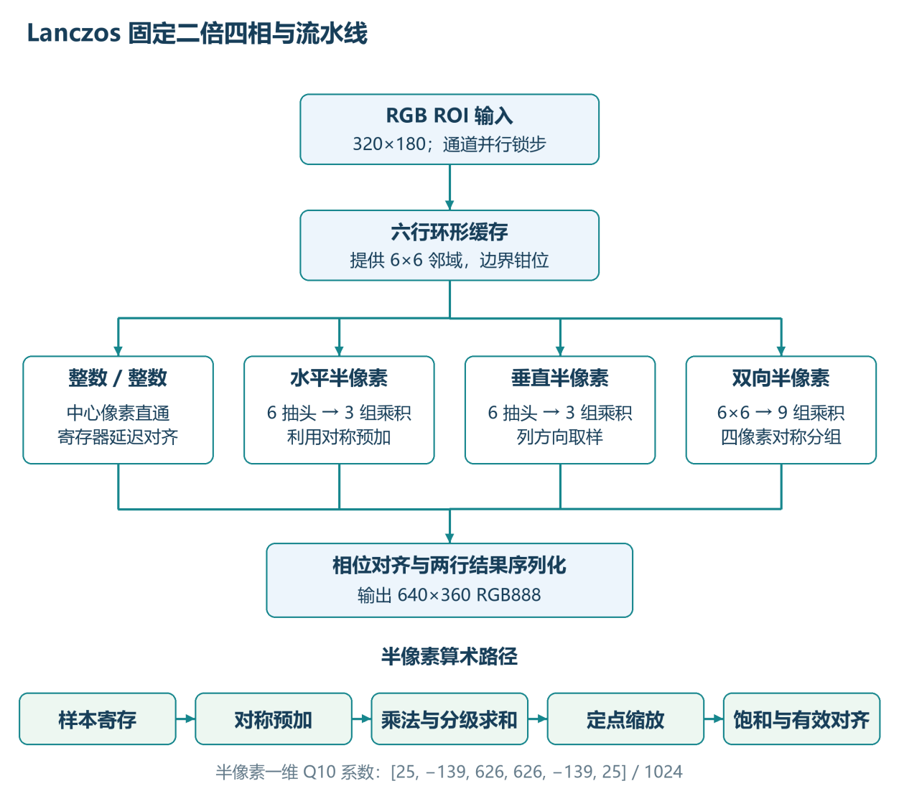
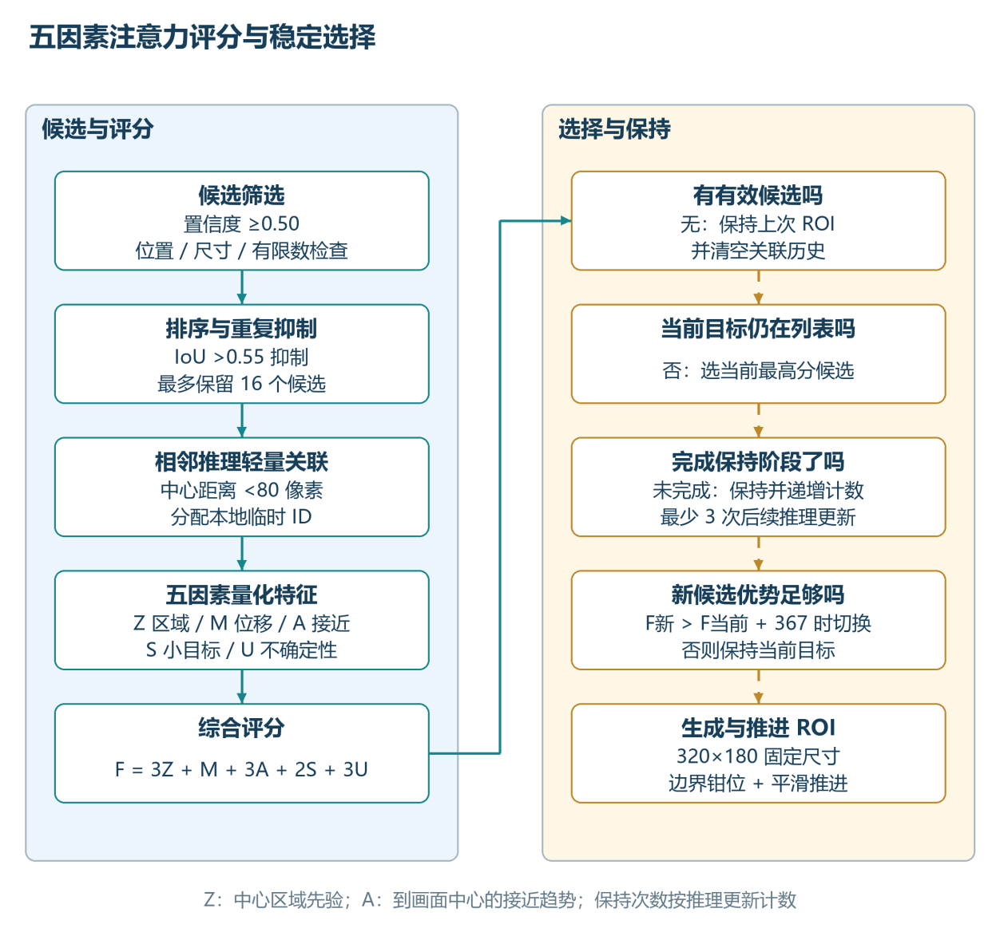

# EagleEye 仿生视觉转播系统——设计报告

本报告介绍 EagleEye 在 XC7Z035 上的仿生视觉系统设计与实现，涵盖视频处理、FPGA 预处理、ARM 人体检测、注意力决策和机械眼联动。项目已完成源码构建、RTL 仿真、板端功能确认、CPU/FPGA 预处理计时及[独立固定输入 Golden 对比](preproc_board_golden_20261029_zh.md)。具体 BIT、应用和模型身份见 [版本说明](release_identity_zh.md)，各项测试条件和验证范围集中于第 3、4 节。

评审可从 [比赛材料与证据索引](contest_evidence_index_zh.md)查看每项要求对应的源码、报告、原始日志和验证边界。

## 1. 背景、目标和范围

EagleEye 面向足球转播等快速运动场景的辅助观察，借鉴人眼周边视觉、选择性注意与中央凹视觉的功能分工，构建“全局感知—注意力选择—局部增强—反馈联动”的处理流程。系统保留摄像头全景，使用人体检测结果选择关注区域，提供局部放大、暂停和鼠标观察，并由双轴机械眼随关注位置联动。

系统采用 XC7Z035、OV5640、HDMI 和 ARM/Paddle-Lite：PS 承担人体检测与视觉决策，PL 承担视频处理、模型输入预处理和 PWM 输出。设计定位为辅助观察，ROI 通过局部重采样改善展示，裁判判断由使用者完成。

### 1.1 选题动机与实际需求

在足球等快速运动的画面中，观察者既要理解运动员在场地中的相对位置，也可能需要看清人物附近的局部细节。目标运动、遮挡、距离和屏幕显示尺寸都会增加观察难度：只看全景时局部目标较小；只盯住局部又容易失去场景上下文。人工在暂停画面中寻找和调整关注区域，也需要反复操作。

团队选择“全景观察与局部复判相结合”作为切入点：在嵌入式设备上保留全景，根据人体检测结果提出关注区域，并支持暂停后用鼠标调整 ROI，双路舵机随关注位置联动。这里的“复判”指对**当前暂停画面**的人工观察；多机位、历史片段、慢动作及轨迹回放属于本原型范围之外的功能。

该方案面向全景与局部之间的目标定位和观察操作。当前模型输出人体框，足球检测、球员身份识别和观察效率对照评估留待后续研究。系统的使用条件包括单摄像头视角、遮挡、输入分辨率和检测误差；放大所呈现的细节来自原始采样。

本项目定位为教学与研究性质的画面观察辅助原型，专业 VAR 的认证和裁判流程属于另一应用层级。报告以源码、工具输出及现场记录介绍已实现功能，使用效果的量化评估按实际测试范围展开。

### 1.2 相关工作及本项目的区别

| 方向及代表性已有工作 | 已有方案解决什么 | 本项目采用或借鉴的部分、主要区别 |
|---|---|---|
| 专业视频回看与 VAR | FIFA 的场馆技术说明介绍了使用比赛转播画面进行视频复核，以及可用于分析的光学跟踪系统 [1]；IFAB 的 VAR 协议规定了受限的复核情形、程序和裁判最终决定权 [2]。 | EagleEye 采用单摄像头全景、暂停画面局部观察与人工 ROI 控制，面向嵌入式观察辅助；专业 VAR 的多机位回放、赛事流程和认证形成了明确的应用范围对照。 |
| 轻量目标检测 | Yu 等提出 PP-PicoDet，研究轻量骨干、检测结构及移动端精度与效率的权衡 [3]；PaddleDetection 提供 PicoDet 的模型配置和部署说明 [4]。 | 本项目复用 PicoDet/Paddle-Lite 在 PS 侧产生人体框，接入规则型注意力及 ROI 控制；其贡献在系统适配与协同。文献性能对应论文平台，XC7Z035 结果见本报告实测部分，临时 ID 用于相邻检测结果关联。 |
| FPGA 图像处理与预处理 | AMD 的 Vitis Vision 库提供颜色转换、分辨率变换等硬件图像处理功能 [5]，说明这类运算已有成熟的可编程逻辑实现思路。 | 本项目将 PL 预处理集成到摄像头、PicoDet 与视频观察链路，完成张量 Golden 仿真及独立固定输入板端验证，并比较两种预处理配置的板端耗时；同算法的配对性能与检测精度比较为后续评估项。 |

**本项目的设计贡献**在于面向快速运动观察场景的软硬件协同：将视频显示、PL 预处理、PS 人体检测、ROI 人工接管及舵机控制组织成一套 XC7Z035 原型，并提供源码、测试记录和复现工具。相关工作提供技术基础，本报告以本项目的实现与测试说明系统价值，与其他完整系统的同条件横向评价留待后续开展。

**参考文献与资料**（网页访问日期：2026-10-28）：

1. FIFA. [Football Stadiums Guidelines: Players and Officials — Football Technology](https://publications.fifa.com/de/football-stadiums-guidelines/technical-guideline/main-user-groups/players-and-officials/). 场馆视频裁判和光学跟踪系统说明。
2. IFAB. [Video Assistant Referee (VAR) protocol, Laws of the Game 2025/26](https://www.theifab.com/laws/2025-26/video-assistant-referee-var-protocol/). 正式 VAR 的适用范围与复核流程。
3. Yu G, Chang Q, Lv W, et al. [PP-PicoDet: A Better Real-Time Object Detector on Mobile Devices](https://arxiv.org/abs/2111.00902). arXiv:2111.00902, 2021.
4. PaddlePaddle. [PaddleDetection PicoDet 模型与部署说明，release/2.6](https://github.com/PaddlePaddle/PaddleDetection/blob/release/2.6/configs/picodet/README_en.md). 模型和 Paddle-Lite 部署资料。
5. AMD. [Vitis Vision Library User Guide](https://docs.amd.com/r/en-US/Vitis_Libraries/vision/overview.html?contentId=tllvbqJ7TwA66BDW6JeAcw). 图像处理库功能参考，用于说明相关技术背景。

### 1.3 四项可核查的设计贡献

以下四项围绕系统组合、规则型视觉决策、资源约束下的视频处理和模型输入适配展开。相关软件的已有许可文本见 [第三方许可](third_party/)；独立卷积研究的范围见第 3 节。

**一、视觉关注与机械眼协同。** 系统将关注区域与双路舵机动作联系起来，为屏幕上的 ROI 提供可观察的物理反馈。[`roi_servo_pwm.v`](../src/servo/roi_servo_pwm.v) 将 ROI 坐标映射为水平、垂直 PWM 目标，并设置中心、范围和渐变步进；暂停后也可通过鼠标调整 ROI。现场已确认鼠标 ROI、按键和舵机等功能正常，[舵机 RTL 仿真](../sim/servo_iverilog_20261027.log)覆盖中心、周期及渐变。机械眼采用 PWM 开环位置控制；机械误差与响应延迟的量化测量列为后续验证项。

**二、人体检测驱动的规则型注意力与 ROI 决策。** [`fovea_roi.hpp`](../src/ps/src/fovea_roi.hpp) 对 PicoDet 人体框进行筛选、去重和相邻推理结果的临时关联，并综合区域、运动、向画面中心接近、小目标和检测不确定度评分；保持次数与切换门槛用于减少目标频繁切换。选中的 ROI 可经过轨迹平滑，暂停时支持人工调整。处理流程为“人体框 → 候选关联 → 多因素评分 → 保持或切换 → ROI 平滑 → 视频观察与控制”。[Attention 应用日志](board_app_evidence_20261028_zh.md)保存了相应输出。权重采用工程规则参数，临时 ID 服务于相邻推理结果关联；其验证范围及应用版本对应关系见第 3 节。

**三、面向视频 ROI 的 Lanczos 放大与资源约束设计。** PL 视频链路将 ROI、双线性/Lanczos 插值、显示模式及 OSD 组合，用于保留全景的同时观察局部。固定 2× 放大利用整数与半像素相位的特点组织计算：整数相位直接取样，半像素相位利用系数对称性折叠计算；[模式选择源码](../src/vivado/eagleeye_7035_eyes.srcs/sources_1/imports/rtl/video_mode_switch_top.v)、[相位核心](../src/vivado/eagleeye_7035_eyes.srcs/sources_1/imports/rtl/lanczos_scaler_core3.v)和 [Q10 系数 ROM](../src/vivado/eagleeye_7035_eyes.srcs/sources_1/imports/rtl/lanczos_coeff_2d_rom.v)可供复核，更多结构说明见[技术材料](lanczos_fpga_brief_20261030.docx)。



如图所示，固定倍率下输出位置分为四种相位：整数相位直接取样，水平和垂直半像素分别将六个抽头对称合并为三组，双向半像素将 6×6 邻域合并为九组。该图描述 RTL 运算组织，实际 DSP 用量以综合与实现报告统计。

团队记录该设计节省约 67% DSP；该比例的独立复算仍需优化前后综合报告。历史独立工程 XSim 日志记录单通道 768 个、RGB 1,536 个输出像素零错误，当前 Eyes 工程另有[资源和时序记录](clean_reproduction_20261028_zh.md)及现场功能确认。不同测试版本的对应关系集中见[仿真记录说明](../sim/lanczos_legacy_readme.md)。

**四、与 PicoDet 对接的 FPGA 预处理 IP。** PL 侧将 640×360 RGB888 输入经双线性缩放和归一化，形成 `1×3×320×320` FP32 NCHW 张量；数据经一路输入 DMA 和三路 R/G/B 输出 DMA 在 IP 与 DDR 之间搬运，PS 侧负责将张量交给 Paddle-Lite 并提供 CPU 回退。见[预处理源码](../src/ip_repo/preproc/)及[硬件接口表](hardware_interfaces_zh.md)。五类帧 RTL 仿真与 Golden 逐位一致；另一次[独立板端固定输入测试](preproc_board_golden_20261029_zh.md)中 307,200/307,200 个值逐位一致。[A/B 计时](preproc_ab_20261028_zh.md)中 CPU 双三次和 FPGA 双线性预处理的平均耗时分别为 416.960 ms、17.537 ms。两组属于不同算法及实时输入的系统配置比较，测试条件见第 4 节；模型推理由 ARM 执行。

项目还提供测试输入、参考张量、RTL 日志、构建报告、BIT/XSA/HWH 和核验脚本，形成由实现到验证的资料链；见[比赛材料与证据索引](contest_evidence_index_zh.md)。

已有第三方许可文本保存在 [许可资料](third_party/)，各组件的使用及再分发范围按对应条款核对。

当前 `model.nb` 按团队来源记录为官方 PicoDet-XS 320 COCO LCNet 导出后转换的 Paddle-Lite ARM 模型，采用原始预训练权重，未由团队训练或量化。PicoDet-S 416 属另一训练路线；模型哈希见[版本说明](release_identity_zh.md)；原始转换资料及权重使用和再分发授权仍待核对，已有框架许可见[许可资料](third_party/)。

## 2. 设计原理与软硬件分工

**工程工具版本：Xilinx Vivado 2022.2。** BD、综合、布局布线与 BIT/XSA 的复现记录见 [干净复现记录](clean_reproduction_20261028_zh.md)。


系统架构如图所示：PL 侧包括摄像头/视频通路、VDMA、ROI 放大及 OSD、图像预处理和 PWM；PS 侧负责 PicoDet 人体检测、ROI 策略、鼠标及控制交互。源码分别位于 `src/vivado/`、`src/ip_repo/`、`src/servo/` 和 `src/ps/`。


预处理将 640×360 RGB888 转为 `1×3×320×320` FP32 NCHW。位宽、DMA/cache、时钟、地址和复位的版本化定义见匹配的源码、XSA 与[接口表](hardware_interfaces_zh.md)。

### 2.1 数据流与接口边界

1. 摄像头数据进入 Eyes 视频链路，PS 程序从视频帧获取检测输入。HDMI 显示与检测更新异步运行，分别记录显示和感知速率。
2. `src/ps/src/paddle_person.cpp` 中的预处理路径将 RGB 帧放入缓冲区，通过一条输入 DMA 和三条 R/G/B 输出 DMA 调用预处理 IP，再形成 NCHW 张量供 Paddle-Lite 使用；`auto` 模式下遇到不可用或运行错误会退回 CPU。源码中的寄存器和缓冲地址是该版本的配置示例，移植时必须对照 XSA、DT 和实际内存归属。
3. PicoDet 输出人体框后，`src/ps/src/fovea_roi.hpp` 中的 AttentionPolicy 对目标筛选、临时匹配并产生 ROI。该本地 ID 不保证跨遮挡稳定；无目标时清除匹配历史并保留最近安全 ROI。
4. 鼠标与 Fovea 请求经过已有控制路径，舵机由相应 PWM RTL 控制。独立 `src/picodet_c_candidate/` 还将人体框送入注意力与调度逻辑；该候选、稳定 GridPolicy 和后续 AttentionPolicy 按独立软件版本管理。

项目以接口源码定义数据与控制行为，并通过现场确认记录系统功能。AttentionPolicy 登录后应用日志与独立 PicoDet 注意力候选的现场反馈分别绑定各自 ELF，详见 [应用证据](board_app_evidence_20261028_zh.md)。

### 2.2 当前实测版本

实测组合采用 `b286f480...` BIT、PicoDet `model.nb` 和 AttentionPolicy 应用；PicoDet 注意力候选的现场功能确认单独记录。完整文件 SHA256、原始证据及不同应用的边界见 [版本说明](release_identity_zh.md)。最终演示若选用其他程序或镜像，应以其实际身份和记录更新该表。

### 2.3 关键接口及版本

Fovea AXI-Lite、预处理 IP、四路预处理 DMA 和视频 VDMA 的地址，已按现场提供的 HWH 与 AttentionPolicy 应用源码逐项整理在 [硬件与软件接口表](hardware_interfaces_zh.md)。该表同时列出帧缓冲与预处理张量的尺寸、格式、源码出处，以及时钟与复位的核对边界。跨板移植时，按目标 XSA、设备树和资源归属更新配置。

系统将连续视频接入、显示和格式转换放在 PL 侧，以匹配视频接口和固定数据流；PS 侧承担模型推理、目标选择及交互控制，便于复用 Paddle-Lite 和调整策略。实际预处理配置的性能收益见第 4 节，分工本身的独立贡献仍需同条件实验量化。

### 2.4 五因素注意力与动态中央凹

在 AttentionPolicy 实现中，检测结果先经过置信度、位置和尺寸筛选，再按置信度排序并抑制重复框；相邻推理结果通过中心距离进行轻量关联。关联只产生本地临时编号，目标发生交叉、遮挡或较大位移时仍可能改变。

每个有效候选按区域、运动、接近趋势、小目标和不确定性五项特征评分。各项被量化到 0～255，当前默认综合评分为：

```text
综合分数 = 3 × 区域 + 运动 + 3 × 接近 + 2 × 小目标 + 3 × 不确定性
```

其中，“区域”采用图像中心的空间先验；“接近”描述目标到画面中心的距离变化；“不确定性”由检测置信度构造。五项均为图像空间的工程特征，权重为当前策略配置；球场语义、物理速度和权重最优性的评估属于后续研究。



默认策略在当前目标仍可关联时，先保持至少 3 次后续推理更新；此后新目标的分数需**严格超过当前分数加 367**才切换。367 是固定分数差，约为参考最大分数 3,060 的 12%，不是当前分数的 12%。没有有效目标时，保留上一次安全 ROI 并清除关联历史。实现见 [AttentionPolicy 源码](../src/ps/src/fovea_roi.hpp)。

选中目标后，系统在 640×360 全局画面上生成固定 320×180 ROI，并对原点进行边界钳位。局部分支横纵各放大 2 倍，形成 640×360 观察窗口；ROI 面积占全局画面的四分之一；该几何比例及其补数 75% 仅描述画面面积，整机计算、功耗和 DDR 流量按各自路径单独测量。ROI 动画按步长向目标移动，每轴单次最多 12 像素；平滑更新负责显示运动，检测 FPS 按新的推理结果统计。

### 2.5 团队分工与接口

按团队确认的 A、B、C 职责，并结合当前板级工程、PicoDet 应用和注意力源码整理。分工表归纳主要职责，文件实现与系统集成由团队协作完成。

| 角色 | 主要分工 | 源码与当前系统边界 |
|---|---|---|
| A：视频、Fovea 与板级集成 | 摄像头输入、VDMA 和视频显示；ROI 局部画布、插值放大、视频模式控制、Fovea 接口及板级工程集成。 | 原 [a-fovea](https://github.com/Zyl-stack/EagleEye_C_Attention_Sim/tree/729a8d05a01ecac1b97351dfc5d1d6654294f304) 分支包含 `video_mode_switch_top.v`、`bilinear_scaler_rgb_top.v`、`fovea_axil_ctrl.v` 和摄像头/VDMA 软件。当前 Z035 版本以本仓库 Eyes 源码和 A 的上板资料为准；现场已确认六项功能正常。 |
| B：PicoDet 人体检测 | 负责 PicoDet 模型与 ARM/Paddle-Lite 推理，产生人体检测框及置信度，供后续关注区域选择使用。 | 当前 Z035 路线的模型与程序见 [`data/model.nb`](../data/model.nb) 和 [`src/ps/`](../src/ps/)；[预处理 A/B 记录](preproc_ab_20261028_zh.md)中两组 PicoDet 推理均在 ARM。 |
| C：注意力与 ROI 调度 | 接收人体目标信息，计算关注度并选择目标；处理保持、切换、ROI 平滑及向 A 的 Fovea 控制接口发出请求。 | 原 [c-attention](https://github.com/Zyl-stack/EagleEye_C_Attention_Sim/tree/e91d713a5b42153d29f7b80ad53ae6709c656716) 分支包含 `attention_score.c`、`attention_scheduler.c`、`bc_adapter.c`、`roi_smoother.c` 和 `a_fovea_adapter.c`。当前 PicoDet+C 独立候选见 [`src/picodet_c_candidate/`](../src/picodet_c_candidate/readme.md)；现场已确认该候选上板功能正常。足球场景的扩展功能按参考分支的验证范围记录。 |
| 团队与 AI 协作 | 需求拆分、接口核对、构建测试与交付资料整理；现场上板由团队执行与确认。 | [AI 协作记录](ai_collaboration_record.md)以案例和真实会话节选呈现开发过程；第三方模型与 IP 的来源和授权单独记录。 |

原 [main](https://github.com/Zyl-stack/EagleEye_C_Attention_Sim/tree/d1253a65f09451d2c48cffbc70d22d12bba3003a) 分支的 `src/main.c` 使用模拟目标数据串联注意力、调度、运动预测与事务状态，属于 PC 软件模拟，板端功能由各自上板资料记录。本仓库的 `reference/github_a_fovea/`、`reference/github_c_attention/` 保存了对应参考快照；原仓库链接的可访问范围由其权限决定。

当前板端 PicoDet 输出 PERSON 人体框，AttentionPolicy 的本地匹配 ID 用于相邻推理结果关联。独立注意力候选的现场反馈与 AttentionPolicy 原始日志分别绑定各自版本。

AttentionPolicy 的五项权重为 3、1、3、2、3，用于人体目标选择。评分对象和图像空间特征见第 2.4 节；独立注意力候选采用自身源码和配置。

## 3. 验证、资源与时序

| 项目 | 仓库证据 | 范围 |
|---|---|---|
| 预处理张量比较器 | `sim/host_preproc.log`：2 项主机测试通过 | 主机比较工具的正反例验证 |
| 预处理 RTL 仿真 | `sim/preproc_iverilog_20261027.log`：五类帧及采集帧适配器联测逐位一致，每帧 307,200 值 | Icarus 10.3 离线数值及流协议验证；板端 DMA/cache 按独立测试记录 |
| 预处理板端固定输入 | [独立板端 Golden](preproc_board_golden_20261029_zh.md)：307,200/307,200 个 FP32 值逐位一致 | 一次固定输入独立程序测试；BOOT 已记录，独立 BIT 关联、摄像头帧新鲜度及整网精度为另外的验证项目 |
| 舵机 PWM RTL 仿真 | `sim/servo_iverilog_20261027.log`：中心保持、周期、渐变及反向测试通过 | 离线 PWM 行为验证；实物限位及供电按现场安全条件核验 |
| ROI 硬件合同检查器 | `sim/host_roi.log`：1 项主机测试通过 | 主机接口检查器测试；实板功能见现场确认 |
| 预处理 IP 独立历史记录 | `sim/preproc_standalone_readme.md` 报告五类帧；六个 RTL/ROM 哈希见 `sim/preproc_standalone_rtl_sha256.txt` | 历史独立 IP 测试说明；原始逐帧日志待归档，完整 Eyes 板端输出按专项测试记录 |
| Lanczos 源码来源 | `sim/host_lanczos_source.log`：7 个文件哈希匹配 | 七文件来源核对；旧 XSim 像素测试另记于 `sim/lanczos_legacy_xsim.txt`，结果为 768 项错误 |
| Lanczos 历史独立仿真 | [单通道日志](../sim/lanczos_single_xsim_pass_legacy.txt)、[RGB 日志](../sim/lanczos_rgb_xsim_pass_legacy.txt) | 分别记录 768 和 1,536 个输出像素零错误；当前 Eyes RTL 的同版本对应关系待核对 |
| 历史实现资源 | `build/z100_top_utilization_placed.rpt`：LUT 24,789；FF 28,234；BRAM 303/500；DSP 49 | 历史 Eyes 布局报告，按该构建版本记录 |
| 历史时序 | `build/z100_top_timing_summary_routed.rpt`：WNS +0.505 ns，WHS +0.051 ns | Vivado 2022.2 已约束路径的 STA 结果；外设时序及稳定性另行评估 |
| 独立 Eyes 重建 | `build/full_rebuild_20261027/`：LUT 24,986、FF 28,246、BRAM 303、DSP 49；WNS +0.608 ns、WHS +0.007 ns | 本机独立源码副本完成实现；12 项输入/33 项输出延迟缺失，CDC 和方法学 Critical 及外部接口时序仍待签核 |
| 复现 BIT 上板 | `report/board_reproduced_20261028_zh.md`；BIT SHA256 `b286f480a1e91282c4be813f35247deffbc6de7d35f31bb9a7984dd3c7fa4a15` | 现场已确认六项功能上板正常；U-Boot 到 Linux 登录及 Attention 应用输出已有原始记录，未额外记录 FSBL 与逐项量化数据 |
| Attention 应用上板日志 | `report/board_app_evidence_20261028_zh.md`：179 条 `ATTENTION`、FPGA 预处理和 `TIME` | 应用日志含 VDMA 错误位警告、帧新鲜度未验证；该日志用于应用行为和计时分析；固定输入张量对比及独立注意力候选按各自记录管理 |
| PicoDet 注意力候选上板反馈 | `src/picodet_c_candidate/readme.md` | 候选功能已有现场确认；AttentionPolicy 原始日志与候选反馈分别绑定对应版本 |
| 历史 CPU 预处理 | `board/attach_100.log` 和 `report/board_measurements.md` | 历史 100 帧基线，按自身版本与条件统计 |

工具报告与板端日志中的时钟、I/O、CDC 和 VDMA 状态集中见 [工程告警说明](warning_review_zh.md)。现场六项功能确认与这些专项检查共同描述系统状态。

文件完整性由 `tools/verify_submission.py` 核验，主机工具、RTL、QEMU 及板端验证按上表分层记录。

### 3.1 测试条件与适用范围

各测试的输入、比较判据、执行记录和复现入口见 [仿真与验证说明](../sim/verification_zh.md)。统一按以下范围引用结果：

- **当前系统**：PicoDet 推理在 ARM 端，PL 执行视频和图像预处理；独立 V2/V3 卷积研究、ARM98 和 V2/R3 实测作为[历史实验](board_evidence_20261027.md)保存。
- **版本绑定**：独立板端 Golden 的 BOOT 已记录，独立 BIT 哈希及与视频测试版本的关系待核对；AttentionPolicy 与独立注意力候选分别绑定日志或现场反馈。
- **场景能力**：临时 ID 用于相邻结果关联，跨遮挡稳定跟踪另需验证；PWM 采用开环控制，机械误差及响应延迟暂无量化记录；长期稳定性和用户观察效率也留待专项测试。
- **历史 Lanczos**：通过与失败日志均保留原文，测试源码及环境的版本对应尚待核对；67% DSP 为团队记录，独立重算需优化前后报告。
- **工程条件**：板级 I/O、CDC/方法学告警及 VDMA 错误位和帧新鲜度问题，按[告警说明](warning_review_zh.md)记录。

## 4. 优化过程与性能、资源记录

现场已提供同一开发板、应用、模型、输入尺寸及线程条件下的两组实板记录：CPU 使用双三次缩放，FPGA 使用双线性缩放；两组先后采集实时画面，每组 35 帧、剔除前 5 帧后统计 30 帧。PicoDet 模型推理在两组均由 ARM 执行。完整条件、原始日志和重算方法见 [预处理 A/B 实板结果](preproc_ab_20261028_zh.md)。

| 指标 | CPU 双三次 | FPGA 双线性 |
|---|---:|---:|
| 保留帧数 | 30 | 30 |
| 平均预处理耗时 | 416.960 ms | 17.537 ms |
| 平均 ARM 推理耗时 | 468.659 ms | 468.204 ms |
| 平均 `total_ms` | 903.150 ms | 502.665 ms |
| `1000 / 平均 total_ms` | 1.107 FPS | 1.989 FPS |

两种配置的预处理均值比为 **23.776 倍**，`1000 / 平均 total_ms` 比值为 **1.797 倍**，平均 `total_ms` 缩短约 44.3%。该结果描述 CPU 双三次与 FPGA 双线性两种实际配置的计时收益。

**计时条件：**两组采用不同缩放算法和先后采集的实时帧；固定输入数值对照由独立测试记录，同算法性能评价待后续开展。`total_ms` 截止检测结果解析，后续 ROI 控制和结果打印在该区间之外。VDMA 提示与 `freshness=unverified` 保留为帧完整性及检测更新率的待验证项，HDMI 刷新按独立指标统计。

历史 `board/attach_100.log` 的 CPU 记录和另一份 179 条 Attention 应用日志，按各自条件保留，见 [计时记录说明](board_measurements.md)。后续[独立板端固定输入 Golden](preproc_board_golden_20261029_zh.md)提供完整张量的一致性结果；实时 A/B 输入的配对检测框精度仍需专项比较。

| FPGA 构建记录 | LUT | FF | BRAM | DSP | WNS/WHS |
|---|---:|---:|---:|---:|---|
| 历史布局报告 | 24789 | 28234 | 303/500 | 49 | +0.505 ns / +0.051 ns（对应历史布线报告） |
| GitHub 干净复现 | 24986 | 28246 | 303/500 | 49 | +0.608 ns / +0.007 ns（已约束路径） |

两行分别展示历史构建与干净复现的资源和已约束时序结果，按版本保留。外部 I/O、CDC 与方法学问题见 [工程告警说明](warning_review_zh.md)。

系统采用显示与 AI 检测异步运行的架构。技术文档中的阶段观察为检测更新约 2 FPS、视频显示约 30 FPS；前者有应用日志供计时复核，后者为观察值，尚待独立显示计时。早期约 0.5 FPS 也为不同条件的阶段观察，保留作开发背景。

## 5. 大模型协作与技能包

项目提炼了视频处理、软硬件接口、模型部署和数据验证的可复用 Skill。PYNQ Overlay、寄存器、DMA 和缓存示例已完成离线模拟验证，为平台迁移提供参考，实板及真实跨项目复用留待后续验证。

[AI 协作主报告](ai_collaboration_record.md)结合真实提示词、模型回答、纠错轨迹和工具结果，展示构建、预处理、交互、性能与机械眼实践；[会话证据索引](ai_collaboration_evidence_20261030.md)保存相关原文节选与来源信息。[技能索引](../skill/index.md)按用途提供工作流、最小示例、适用条件和验证方法，AX7020 经验按独立参考案例收录。Lanczos 历史记录见[验证说明](../sim/lanczos_legacy_readme.md)。

协作案例展示了 AI 在环境排障、接口适配、统计复核及资料整理中的效率价值：依据真实 BusyBox 功能修订采集工具，将固定输入 Golden 和配置性能分别评估，并以版本化记录连接构建产物与现场结果。各案例提供来源、修正过程及测试结果，读者可按证据索引追溯相关会话。

## 6. 复现

1. 执行 `python tools/verify_submission.py` 验证当前仓库与原始快照。
2. 先运行 `python tools/restore_a_repro.py --output <新目录>` 恢复工程快照，再按 `report/reproduction_zh.md` 使用 `build/build_full_vivado.tcl` 运行 Vivado 2022.2。
3. 按 `report/reproduction_zh.md` 及原快照 `sim/README.md`、`src/ps/build_arm.sh` 准备工具链、Paddle-Lite 依赖及测试输入。独立构建已覆盖 Eyes FPGA、稳定 ARM 应用和固定源码 Linux 内核；现场记录提供的板测 BIT 与 2026-10-27 复现 BIT 哈希一致；2026-10-28 干净复现 BIT 的配置数据一致但整文件哈希不同。实验卡读回清单和现场运行文件独立哈希列于[版本说明](release_identity_zh.md)的待核对项。
4. 上板验证应使用获准的独立介质，记录镜像身份、测试条件、原始输出和恢复情况；不覆盖稳定系统。

提交材料逐项核查见 [提交检查](submission_check_20261028_zh.md)，详细缺口和证据边界见 `submission_audit.md`。
